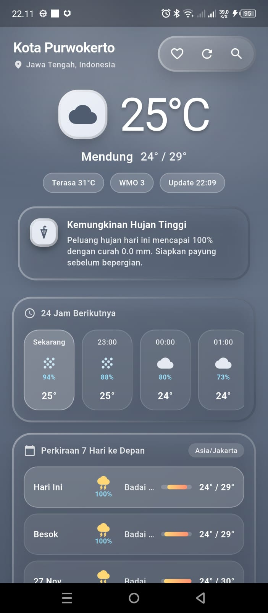
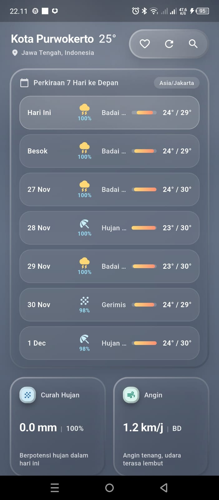
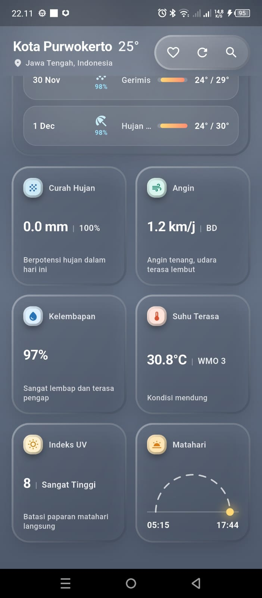
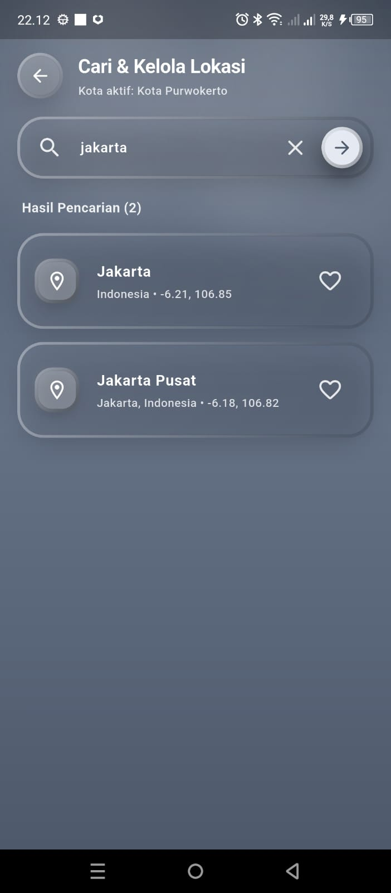
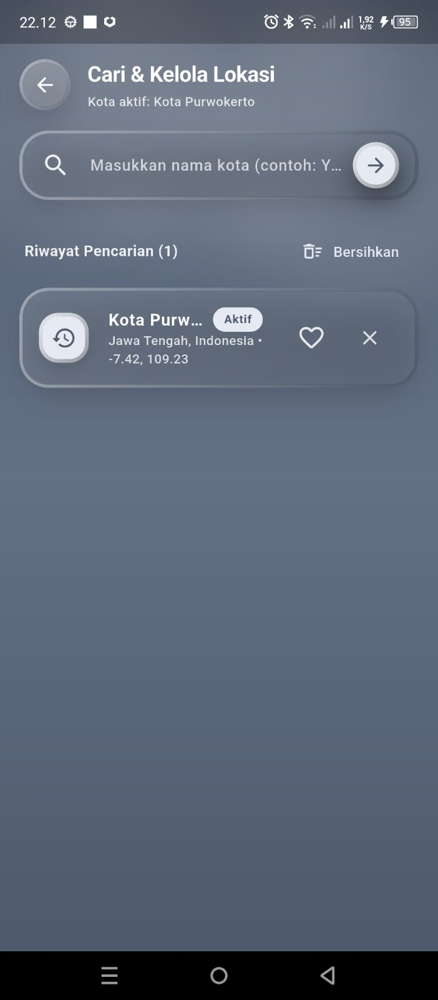

# WeatherApp — Responsi Flutter (Open-Meteo & MVVM)

Aplikasi informasi prakiraan cuaca berbasis **Flutter & Dart** yang dikembangkan menggunakan arsitektur **Model-View-ViewModel (MVVM)**, state management **Provider**, penyimpanan lokal **SharedPreferences**, dan integrasi **Open-Meteo REST API** (Weather Forecast API & Geocoding API).

---

## 1. Struktur Aplikasi

```text
lib/
├── main.dart                                # Entry point & konfigurasi MultiProvider + MaterialApp
├── core/
│   ├── theme/
│   │   ├── app_theme.dart                   # Konfigurasi Material 3 Theme (Light/Dark) & Typography
│   │   └── clay_styles.dart                 # Palet warna terkurasi & komponen 3D Claymorphism
│   └── utils/
│       └── weather_code_helper.dart         # Pemetaan kode cuaca WMO ke deskripsi, ikon, dan gradien
├── models/
│   ├── location_model.dart                  # Model lokasi kota (Geocoding JSON & SharedPreferences JSON)
│   └── weather_model.dart                   # Model data cuaca (WeatherModel, CurrentWeather, HourlyForecast, DailyForecast)
├── services/
│   ├── open_meteo_service.dart              # HTTP GET client untuk Open-Meteo Forecast & Geocoding API
│   └── local_storage_service.dart           # Penyimpanan lokal (favorit, riwayat pencarian, kota terpilih)
├── viewmodels/
│   ├── weather_viewmodel.dart               # State management cuaca, favorit, dan riwayat pencarian
│   └── location_search_viewmodel.dart       # State management pencarian kota ke Geocoding API
└── views/
    ├── home_weather_screen.dart             # Screen 1: Home / Weather Screen
    ├── search_location_screen.dart          # Screen 2: Search / Location Screen
    └── widgets/
        ├── current_weather_card.dart        # Hero cuaca terkini & saran kondisi dinamis
        ├── hourly_forecast_strip.dart       # Strip perkiraan 24 jam berikutnya
        ├── weather_metrics_grid.dart        # Grid detail cuaca (hujan, angin, UV, busur matahari)
        ├── daily_forecast_list.dart         # Daftar perkiraan cuaca 7 hari ke depan
        └── state_feedback_view.dart         # Tampilan reusable untuk state kosong dan error
```

---

## 2. Penerapan Arsitektur MVVM

1. **Model (`lib/models/`)**
   - `LocationModel`: Merepresentasikan data lokasi kota (`id`, `name`, `latitude`, `longitude`, `country`, `admin1`, `timezone`) dengan factory `fromGeocodingJson` untuk respons Geocoding API serta `fromJson`/`toJson` untuk penyimpanan lokal.
   - `WeatherModel`, `CurrentWeather`, `HourlyForecast`, dan `DailyForecast`: Mengurai respons JSON dari Open-Meteo Forecast API menjadi objek Dart yang aman dari nilai null.
2. **Service (`lib/services/`)**
   - `OpenMeteoService`: Menjalankan HTTP `GET` ke endpoint Open-Meteo dan menangani error jaringan, timeout, maupun status HTTP non-200 melalui `WeatherApiException`.
   - `LocalStorageService`: Menyimpan daftar **lokasi favorit**, **riwayat pencarian**, dan **lokasi aktif terakhir** menggunakan `SharedPreferences` sehingga tetap tersedia saat aplikasi dibuka kembali.
3. **ViewModel (`lib/viewmodels/`)**
   - `WeatherViewModel` & `LocationSearchViewModel` memperluas `ChangeNotifier` dan disediakan ke UI menggunakan `Provider` (`MultiProvider`).
   - ViewModel memisahkan logika bisnis, status `isLoading`, `errorMessage`, data kosong, serta sinkronisasi penyimpanan lokal dari widget UI.
4. **View (`lib/views/`)**
   - `HomeWeatherScreen` & `SearchLocationScreen` (`StatefulWidget`) beserta widget modular (`StatelessWidget` di `views/widgets/`) hanya membaca state dari ViewModel (`context.watch`) dan memicu aksi ViewModel (`context.read`) tanpa melakukan pemanggilan HTTP langsung.

---

## 3. Implementasi Open-Meteo API

Semua data cuaca dan pencarian kota diambil secara langsung menggunakan **HTTP GET** (`package:http`):

### a. Weather Forecast API
- **Endpoint**: `https://api.open-meteo.com/v1/forecast`
- **Parameter**:
  - `latitude`, `longitude` — koordinat lokasi terpilih
  - `current` — `temperature_2m,relative_humidity_2m,apparent_temperature,precipitation,weather_code,wind_speed_10m,wind_direction_10m,is_day`
  - `hourly` — `temperature_2m,weather_code,precipitation_probability`
  - `daily` — `weather_code,temperature_2m_max,temperature_2m_min,precipitation_probability_max,sunrise,sunset,uv_index_max`
  - `timezone=auto`
  - `forecast_days=7`

### b. Geocoding API
- **Endpoint**: `https://geocoding-api.open-meteo.com/v1/search`
- **Parameter**:
  - `name` — kata kunci nama kota dari input pengguna
  - `count=15`
  - `language=id`
  - `format=json`

---

## 4. Fitur Utama

- **Home / Weather Screen**:
  - Menampilkan nama kota terpilih, kondisi cuaca terkini beserta kode WMO, dan suhu saat ini (`current.temperature_2m`).
  - Menampilkan detail tambahan: suhu yang dirasakan (`apparent_temperature`), kelembapan (`relative_humidity_2m`), kecepatan angin (`wind_speed_10m`), curah hujan (`precipitation`), kode kondisi cuaca (`weather_code`), serta peluang hujan maksimum (`daily.precipitation_probability_max`).
  - Menampilkan perkiraan cuaca 7 hari ke depan (`temperature_2m_max`, `temperature_2m_min`, `precipitation_probability_max`, dan `weather_code`).
  - Quick-switch chips untuk kota favorit, tombol favorit, pull-to-refresh, serta penanganan loading, data kosong, dan error.
- **Search / Location Screen**:
  - Pencarian kota real-time dengan debounce dan tombol submit langsung ke Open-Meteo Geocoding API.
  - Menyimpan dan menghapus lokasi favorit serta riwayat pencarian ke `SharedPreferences`.

---

## 5. Screenshot Aplikasi

### a. Home / Weather Screen

| Tampilan Utama | Prakiraan 7 Hari ke Depan | Detail Metrik & Busur Matahari |
| :---: | :---: | :---: |
|  |  |  |
| Menampilkan nama kota (*Kota Purwokerto*), suhu saat ini (`25°C`), kondisi (*Mendung*, WMO 3), saran cuaca dinamis, dan prakiraan 24 jam berikutnya | Menampilkan header ringkas saat di-scroll (`Kota Purwokerto 25°`) dan daftar prakiraan cuaca 7 hari lengkap dengan peluang hujan & bar rentang suhu | Menampilkan grid detail **Curah Hujan**, **Angin**, **Kelembapan**, **Suhu Terasa**, **Indeks UV**, serta busur lintasan **Matahari** |

### b. Search / Location Screen

| Pencarian Lokasi via Geocoding API | Riwayat Pencarian & Status Lokasi Aktif |
| :---: | :---: |
|  |  |
| Pencarian kota langsung ke Open-Meteo Geocoding API (`jakarta`), dilengkapi tombol favorit | Menampilkan riwayat pencarian tersimpan (`SharedPreferences`), badge lokasi `Aktif`, dan tombol kelola riwayat |

---

## 6. Menjalankan & Menguji Aplikasi

```bash
flutter pub get
flutter analyze
flutter test
flutter run
```
